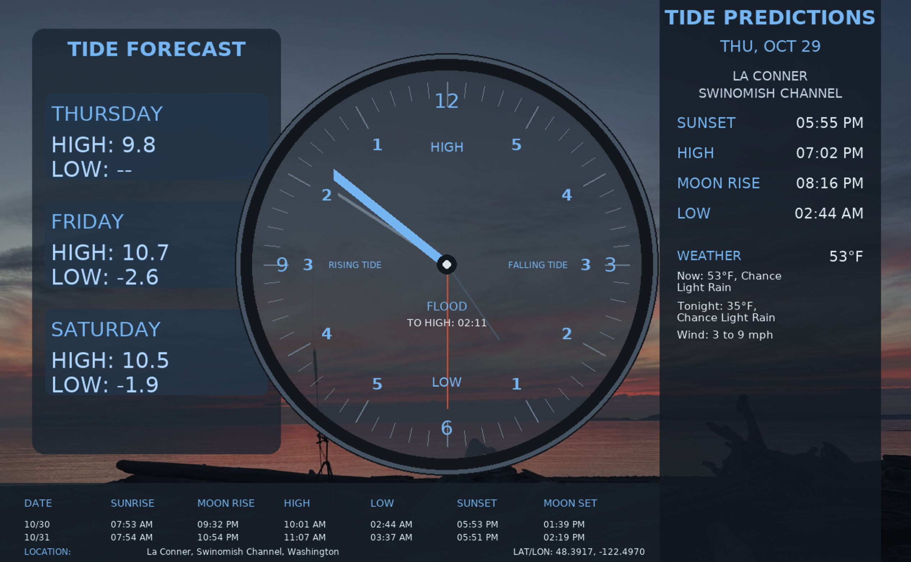

# pyTide

pyTide is a Pi-friendly tide clock built around XTide and pygame-ce for Ubuntu Linux on Pi like devices.



It is designed to:

- render a fullscreen or windowed tide clock
- read predictions from a local XTide installation
- update harmonics automatically from OpenWater Slackwater GitHub releases


## Quick start

1. Run the automated install (app + XTide + initial harmonics):

   `sudo bash scripts/install.sh --user pi --install-dir /opt/pytide --with-xtide`

2. Set your tide station see [Set Station](#set-the-tide-station-location-and-weather-coordinates)

3. Optional manual launch in windowed mode:

   `python -m app.main --windowed`


## One-command install and autolaunch

For Raspberry Pi/Ubuntu deployments, use the helper scripts:

1. Install and enable systemd autolaunch service:

   `sudo bash /opt/pytide/scripts/setup-autolaunch.sh --user pi --install-dir /opt/pytide`

2. Validate service status:

   `systemctl status pytide.service --no-pager`

## Uninstall and rollback

To remove only the autolaunch service:

```bash
sudo bash /opt/pytide/scripts/uninstall.sh --service-name pytide --install-dir /opt/pytide
```

To remove both service and install directory:

```bash
sudo bash /opt/pytide/scripts/uninstall.sh --service-name pytide --install-dir /opt/pytide --purge
```

## CLI options

Run options are parsed in `app/config.py` via `TideClockConfig.from_args`.
CLI flags override any values loaded from `settings.example.json` and `settings.json`.

### Station and XTide

- `--station` (default: `LOCAL STATION`): XTide station name to render.
- `--xtide-path` (default: `/usr/local/bin/tide`): Path to the XTide `tide` executable.
- `--harmonics-dir` (default: `/usr/local/share/xtide`): Directory containing harmonics files.
- `--harmonics-url` (default: `https://api.github.com/repos/openwatersio/slackwater-database/releases/latest`): GitHub latest release endpoint used to resolve the newest harmonics `.tcd` asset.
- `--cache-dir` (default: `.pytide-cache`): Local cache directory.
- `--tide-height-unit` (default: `ft`): Display/output unit for tide heights (`ft` or `m`). The alias `f` is accepted for feet.

### Coordinates and weather

- `--latitude` (default: `None`): Latitude for NOAA weather calls. Supports decimal or cardinal suffix (for example `48.4N`).
- `--longitude` (default: `None`): Longitude for NOAA weather calls. Supports decimal or cardinal suffix (for example `122.6W`).
- `--weather-refresh-seconds` (default: `14400`): Weather polling interval in seconds.
- `--disable-weather` (flag): Disable weather fetch entirely.

### Window and refresh behavior

- `--fullscreen` (flag): Launch in fullscreen mode.
- `--windowed` (flag): Launch in windowed mode.
- `--width` (default: `1280`): Window width in pixels.
- `--height` (default: `800`): Window height in pixels.
- `--refresh-seconds` (default: `300`): App refresh interval in seconds.
- `--harmonics-refresh-hours` (default: `336`): Harmonics refresh age threshold in hours.

### Theme and background

- `--theme` (default: `light`): Theme preset (`light` or `dark`).
- `--background-image` (default: `img/beach.jpeg`): Background image path.
- `--disable-background-image` (flag): Disable background image and use theme background color.
- `--background-overlay-alpha` (default: `88`): Global background shade alpha (`0-255`).

### Transparency controls

- `--panel-alpha` (default: `188`): Left forecast panel alpha (`0-255`).
- `--card-alpha` (default: `188`): Forecast card alpha (`0-255`).
- `--rail-alpha` (default: `212`): Right panel alpha (`0-255`).
- `--table-alpha` (default: `210`): Bottom table alpha (`0-255`).
- `--clock-face-alpha` (default: `140`): Clock-face tint alpha (`0-255`).

## Layout

- `app/config.py` - configuration defaults and data classes
- `app/harmonics_updater.py` - harmonics download and fallback logic
- `app/xtide.py` - XTide invocation and forecast parsing
- `app/render.py` - pygame-ce clock rendering
- `app/main.py` - app entry point and CLI
- `tests/test_xtide_parser.py` - parser smoke tests


### Mode notes

- If neither `--fullscreen` nor `--windowed` is provided, the app defaults to windowed mode.
- Alpha values are clamped to `0-255`.

## Automatic harmonics updates

The app keeps a local copy of the harmonics file and refreshes it when it is older than the configured age window (default: 336 hours / 14 days).

```python
from app.harmonics_updater import refresh_harmonics_if_needed

path = refresh_harmonics_if_needed("/usr/local/share/xtide", max_age_hours=336)
print(path)
```
This resolves the newest OpenWater Slackwater release asset by default and falls back to the newest local `.tcd` file and then `last_known_good.tcd` if the network download fails.

## Set the tide station location and weather coordinates

XTide needs a specific station name; the clock will not work correctly until the configured station matches a real entry in your harmonics file.

List the available stations:

```bash
/usr/local/bin/tide -m l
```

Then choose a station and set it in the app configuration. The simplest approach is to pass it on the command line:

```bash
python -m app.main --station "La Conner, WA United States" 
```

Or copy example config `settings.example.json` to `settings.json`:

```json
{
  "station": "La Conner, WA United States"
}
```

Keep the station name exactly as listed by XTide, including commas and punctuation.

